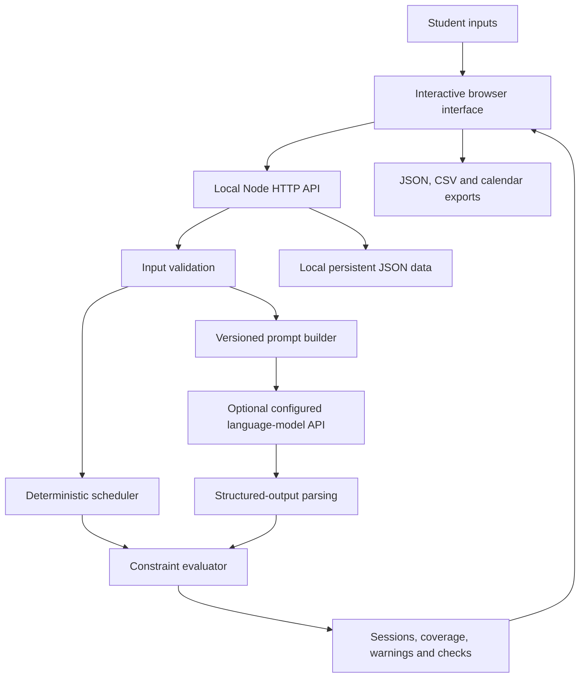

# Smart Study Planner
## A Constraint-Based AI Timetable Generator (C20)

**Course:** Prompt Engineering, B.Tech 5th Semester, Bennett University  
**Academic year:** 2026  
**Document status:** Technical report draft; complete the personal details and evidence items before submission.

| Field | To be completed by the team |
|---|---|
| Team members and enrolment numbers | [Enter actual names and enrolment numbers] |
| Faculty / mentor | [Enter name] |
| Section / group | [Enter details] |
| Source repository or submission folder | [Enter accessible final link] |
| Submission date | [Enter actual date] |
| Approved team size and milestone schedule | [Confirm from the official LMS] |

### Declaration and acknowledgement

Use the institution's prescribed declaration or certificate if one is required. Do not sign or state that faculty approval, stakeholder interviews, or individual contributions occurred unless they did. Acknowledge the course problem bank, the software and model providers actually used, and AI-assisted development. Suggested disclosure wording appears in Chapter 8.

### Abstract

Smart Study Planner addresses C20, the timetable and study-plan generator in the course problem pool. A student supplies subjects, exam dates, estimated preparation hours, weekly availability, and study preferences. The application turns these inputs into a day-wise timetable and makes feasibility visible through automated constraint checks. The design combines a deterministic scheduling backend with an optional language-model experiment workflow. The scheduler allocates study sessions within available windows, reserves breaks, respects daily study limits, and places preparation before each subject's exam. When the requested workload cannot be allocated, the output reports the remaining hours instead of presenting an incomplete schedule as complete. A Prompt Lab preserves baseline, structured, and refined prompt versions so that genuine model outputs can be compared against the same validation criteria. The interface supports timetable inspection, subject management, completion tracking, and exports. This report explains the problem, prompt design, implementation, evaluation protocol, limitations, and responsible-use considerations. Automated scheduler results and live language-model results are treated as separate evidence; learning gains and prompt improvements require additional measurements and are not assumed.

### Contents

1. Introduction
2. Problem and domain analysis
3. Existing solutions and literature
4. Prompt and solution design
5. Prompt development and implementation
6. Evaluation and testing
7. Results and discussion
8. Responsible AI and impact
9. Conclusion and future scope
10. References and appendices

## Chapter 1 - Introduction

### 1.1 Problem context

Exam preparation requires students to coordinate multiple subjects with different deadlines and workloads. A list of tasks does not establish whether there is enough free time to complete them. A timetable can appear convincing while containing overlaps, studying after an exam, or allocating more work than the student can realistically perform in a day. C20 defines the target transformation as subjects, exam dates, and free hours into a day-wise study plan, using constraint-based prompting, structured output, and constraint checking [1, Appendix A, page 12].

### 1.2 Motivation and project objectives

The project makes the proposed plan inspectable. It aims to:

- Capture concrete study requirements and availability through a usable interface.
- Produce sessions that satisfy explicit time and workload constraints.
- Explain capacity shortfalls and distinguish a valid partial plan from a complete plan.
- Demonstrate prompt versions with different levels of structure and constraints.
- Compare recorded outputs with a reproducible evaluator rather than subjective appearance alone.
- Preserve source code, prompts, examples, and evaluation evidence for demonstration and assessment.

### 1.3 Users and scope

The primary user is a student planning exam preparation. Faculty and teammates are secondary users who inspect the prompt workflow and evidence. The delivered local application is intended for an individual demonstration. It is not a university course-registration system, a multi-user institutional service, an academic performance predictor, or a substitute for the student's judgment.

## Chapter 2 - Problem and Domain Analysis

### 2.1 Inputs and outputs

| Input | Meaning |
|---|---|
| Planning start and end dates | Inclusive date range for study sessions |
| Subjects and topic labels | Student-provided preparation context; no assumed syllabus |
| Exam date per subject | Sessions must finish on a calendar date before that exam |
| Required study hours | Student estimate of the workload for each subject |
| Priority and difficulty | Scheduling preferences, not validated measurements of ability |
| Weekly availability | One or more allowed time windows for each weekday |
| Blocked dates | Dates on which no study is scheduled |
| Session length and break length | Desired work periods and minimum separation |
| Maximum daily study hours | Upper limit on scheduled work per day |
| Preferred time | Soft preference for morning, evening, or balanced allocation |

Outputs include sessions, subject-level allocated and remaining minutes, warnings, explicit constraint checks, and summary metrics. Session fields identify the subject, date, start/end time, duration, topic, study or revision label, and a concise allocation rationale. Completion tracking records a user's action; it is not independent proof of learning.

### 2.2 Hard constraints and soft preferences

Hard constraints define whether a session is admissible: valid dates and times, known subject IDs, availability, blocked dates, non-overlap, minimum breaks, daily study limits, exam deadlines, and no excess allocation beyond the requested workload. Meeting every hard constraint does not mean that every requested hour has been scheduled. Workload coverage must therefore be reported separately.

Soft preferences influence which feasible session is chosen, such as urgency, subject priority, difficulty, balance, and preferred time of day. A preference must never silently override a hard constraint. The deterministic scheduler uses a heuristic and does not claim a globally optimal timetable or a proof that no better allocation exists.

### 2.3 Evidence and assumptions

The course problem statement is the initial evidence for the use case. No student survey or faculty interview is included as completed evidence in this draft. Before final submission, collect a small consent-based usability review and record the actual observations. The planner assumes that user-entered deadlines, availability, and workload estimates are correct. It does not infer preparation needs from marks, health information, or demographic characteristics.

### 2.4 Acceptance criteria

1. A valid request can produce and display an inspectable timetable.
2. Invalid inputs produce actionable errors instead of corrupted schedules.
3. Every generated session can be checked against the original constraints.
4. Unallocated workload remains visible by subject.
5. Saved data and experiment records remain available after restarting the local application.
6. Exports can be used outside the interface.
7. Every experiment identifies its execution mode and preserves the actual output.
8. A missing API key does not prevent local scheduling, and local results are never labelled as model-generated evidence.

## Chapter 3 - Existing Solutions and Literature

### 3.1 Comparison of workflow types

This is a conceptual comparison of approaches, not a benchmark of named commercial products.

| Approach | Useful property | Gap addressed by this project |
|---|---|---|
| Paper timetable or spreadsheet | Direct human control and simple editing | Capacity checks and rescheduling require manual effort |
| Calendar entries | Clear time blocks and reminders | The user must decide allocations and verify subject workload |
| Unstructured request to a language model | Flexible natural-language interaction | A fluent table may still violate dates, breaks, or available hours |
| Deterministic constraint scheduler | Reproducible allocation and explicit checks | Does not itself demonstrate language-model prompting |
| Proposed combined workflow | Constraint scheduling plus recorded prompt experiments | Requires separate evaluation of scheduling and model behaviour |

### 3.2 Prompt-engineering basis

Brown et al. demonstrate language-model tasks specified through text instructions and examples without task-specific gradient updates. This supports the use of clearly described tasks and a small example in a prompt; their results do not establish that this timetable application will improve [2].

Madaan et al. investigate generating feedback and revising model outputs. Their work motivates treating an initial answer as something to inspect and improve. This project uses explicit programmatic constraints as an external check; it should not claim to reproduce the paper's full experimental method [3].

### 3.3 Project contribution

The contribution is an assessable workflow that connects user constraints, versioned prompts, structured sessions, machine checks, and visible shortfalls. The intended research question is: **For a fixed set of study-planning inputs and the same model configuration, do explicit constraints and an output schema improve measured validity and workload coverage compared with a baseline prompt?** The answer must come from recorded experiments. An implemented prompt hierarchy alone does not establish improvement.

## Chapter 4 - Prompt and Solution Design

### 4.1 Task decomposition

1. Capture and validate the student's structured inputs.
2. Construct a prompt using the selected version and the same input context.
3. Generate a candidate either with the deterministic scheduler or an explicitly selected configured model.
4. Parse candidate sessions and evaluate them against the original inputs.
5. Display sessions, warnings, coverage, and failed checks together.
6. Preserve the experiment and let the student inspect or revise the inputs.

The application separates the ability to produce a plan from evidence that a language-model prompt works. The local algorithm is useful without a provider connection; its output is a rule-based result.

### 4.2 Architecture

### 4.3 Prompt versions

| Version | Design purpose | What to inspect |
|---|---|---|
| v1 - Baseline | Request minimal JSON with the planning input, without an API-enforced schema | Does the output omit constraints or produce an unusable format? |
| v2 - Structured | Add explicit constraints and an API output schema | Does improved structure reduce parsing and identification errors? |
| v3 - Refined | Add boundary examples, independent validation, and at most one repair attempt after an invalid or malformed candidate | Does validity improve without hiding unscheduled workload? |

The executable prompt templates are the authoritative version of the wording. `PROMPT-ITERATIONS.md` explains the intended differences and provides a recording protocol. Prompt-development rationale is a design hypothesis until actual experiment results support it.

### 4.4 Output contract and grounding

Each session refers to an existing subject ID and uses a calendar date and `HH:MM` times. No subject, exam date, or availability window should be invented. User-supplied topic names are data, not instructions that can override the scheduling rules. The student should see a brief reason for an allocation; private model reasoning is not required. A schema-conforming response still requires semantic checks because valid JSON can contain an invalid timetable.

## Chapter 5 - Prompt Development and Implementation

### 5.1 Technology choices

The project uses a browser interface with HTML, CSS, and JavaScript and a local Node.js backend. The scheduling logic is dependency-free JavaScript, allowing the same core checks to run in automated tests. Persistent JSON storage is appropriate for a small individual demonstration and keeps setup simple. It is not designed for concurrent institutional use. The optional live workflow supports Responses and compatible Chat Completions APIs through a settings screen. The OpenAI `.env` configuration remains a fallback. Syllabus extraction adds pdf-parse and Mammoth runtime dependencies; see the README for installation. There is no assumed model default. API credentials must never appear in exported project evidence or frontend code.

Structured output makes a response conform to a defined shape, but the application's independent evaluator is still needed for scheduling constraints. The refined version may make one repair request informed by failed checks or parsing errors; network, timeout and provider transport failures do not trigger model repair. An invalid candidate is retained as experiment evidence and is not accepted as the timetable. Record initial and repair outcomes separately; successful repair is an observation, not an assumed feature benefit. Consult the provider's [structured-output documentation](https://developers.openai.com/api/docs/guides/structured-outputs) for the API mechanism [4].

### 5.2 Principal modules

| Module | Responsibility |
|---|---|
| Planner interface | Configure subjects and availability, generate plans, inspect sessions |
| Scheduling engine | Allocate available minutes while respecting hard constraints |
| Constraint evaluator | Independently compare sessions with the request |
| Prompt Lab | Select prompt versions, execute supported experiment modes, inspect evidence |
| Persistence | Save planner state and experiment records locally |
| Exports | Provide structured data and calendar/table representations |
| Automated tests | Exercise ordinary, invalid, and constrained cases |

Use the root README for the exact start commands, environment variables, and implemented endpoint names. Record the actual Node version, source revision, configured provider/model, and run date with any final experiment results. Do not replace these fields with assumed defaults in a published report.

### 5.3 Iteration process

Development proceeds from an explicit input contract to validation, scheduling, evaluation, and presentation. Prompt changes should be motivated by observed error categories, such as malformed JSON, unknown subjects, deadline errors, or omitted workload. Keep unsuccessful outputs alongside successes. When changing more than one prompt feature at once, avoid claiming that a particular feature alone caused the result.

## Chapter 6 - Evaluation and Testing

### 6.1 Separate evaluation tracks

**Track A: software and scheduler verification.** `npm test` runs the automated suite. `npm run evaluate` runs 12 fixed synthetic cases and writes `docs/evaluation-results.json` as measured scheduler evidence. It records the timestamp, case names, inputs, expected allocations, observed sessions, and checks. Valid cases require every hard check to pass and the allocation to match the case's expected minutes; invalid-input cases require a validation error with status 400. The UI evaluation action runs the same cases and stores its result in `data/state.json`, without rewriting the documentation artifact. Neither result is evidence of language-model performance.

**Track B: live prompt comparison.** Use the same input cases, provider, model, and supported generation settings for v1, v2, and v3. Record actual raw outputs, parsed sessions, errors, timings, and check results. If no live model run has been performed, label this track **not yet measured**. The rule-based mode may demonstrate the interface and validator but must not stand in for a prompt A/B experiment.

**Track C: human usefulness review.** Ask consenting students to complete the same tasks: add a subject, change availability, identify a shortfall, and export a plan. Record actual task outcomes and comments. Human review remains pending until conducted.

### 6.2 Test matrix

| Case | Input condition | Expected property |
|---|---|---|
| Typical week | Several subjects and adequate availability | Valid sessions; coverage reported |
| Insufficient capacity | Required hours exceed available minutes | Shortfall warning; no extra availability invented |
| Imminent exam | A subject has little time before its exam | No session on or after the exam date |
| Blocked day | A date is explicitly unavailable | No session on that date |
| Multiple daily windows | Two separated availability windows | Sessions remain within windows and preserve breaks |
| Tight daily cap | Availability exceeds permitted work hours | Scheduled work remains within the cap |
| Fractional workload | Required hours are not whole numbers | Minute accounting is consistent |
| Invalid request | Bad date/time, duplicate subject IDs, or malformed data | Clear rejection before scheduling |
| No usable availability | No feasible study slots | Honest empty/partial output and unmet workload |
| Untrusted topic text | A topic contains instruction-like wording | Text does not gain authority over constraints |
| Malformed model output | Invalid JSON or wrong fields | Parsing error recorded; no fabricated repaired success |
| Unsupported model plan | Unknown subjects or overlapping sessions | Relevant checks fail visibly |

Not every row is automatically exercised by every runner. List the test cases actually executed in the final evidence, and mark manual or pending cases accordingly.

### 6.3 Metrics and rubric

| Metric | Definition | Interpretation |
|---|---|---|
| Parse success | Outputs successfully decoded into the required structure / all attempted outputs | Measures machine usability, not scheduling correctness |
| Hard-constraint pass rate | Passed hard checks / applicable checks for a candidate | Include failed check names; aggregate rate can hide severe errors |
| Fully valid candidate rate | Candidates with every hard check passing / all attempted candidates | A valid candidate may still be partial or empty |
| Workload coverage | Allocated requested minutes / total requested minutes | Report per subject and overall; do not overcount excess minutes |
| Unscheduled minutes | Requested minutes minus validly allocated minutes | Makes incompleteness visible |
| Latency | Measured elapsed time for the named operation | Record execution mode and environment |
| Human usefulness | Reviewer score with an explicit rubric and explanation | Report sample size and disagreement |

Suggested human rubric: 1 = unusable or confusing; 2 = major revision needed; 3 = useful with several corrections; 4 = useful with minor corrections; 5 = clear and immediately usable. Obtain actual ratings before reporting an average. An empty plan can pass overlap and deadline checks, so completeness must always accompany validity.

The table above defines the full analysis rubric; some measures require aggregating exported experiments or conducting a human review. The application directly stores a whole-percent hard-check pass rate, one-decimal coverage, elapsed milliseconds and accepted session count. It excludes `coverage` from the hard-check percentage. The core evaluator has ten hard categories, while AI evaluation adds topic grounding. A failed AI candidate retains its last-attempt checks but contributes no accepted sessions; inspect the error and attempts alongside the score. Parse success and fully valid candidate rates across repeated runs must be calculated from the retained records, not inferred from one displayed percentage.

The live adapter records actual prompts, raw text, check results, errors, and usage metadata when returned. It sends a 16,000 output-token limit and `store: false`; temperature is not specified. v3 latency includes any repair request. Only the latest 100 experiment records remain in local history, so export older evidence when needed. No live OpenAI request has been used to populate the supplied project evidence.

### 6.4 Reproducible prompt experiment protocol

1. Freeze at least five cases, including ordinary, tight-capacity, imminent-exam, blocked-date, and impossible-workload cases.
2. Export the exact input JSON and save prompt versions before running.
3. Hold the provider/model and other supported settings constant. Record settings that the API does not expose.
4. Run each case with all versions. Repeat each combination if resources permit, recording every attempt rather than only the best output.
5. Preserve the raw output and parse result. Count provider failures separately from invalid model responses.
6. Evaluate candidates against the same original request. Do not silently alter constraints to make a candidate pass.
7. Compare both validity and coverage, explain failure categories, and avoid claims of statistical significance from a small demonstration sample.

## Chapter 7 - Results and Discussion

### 7.1 Evidence status

This report is deliberately not populated with invented benchmark figures. Read the generated evaluation artifact and exported experiment records before replacing the following entries.

| Evidence | Source | Reporting status |
|---|---|---|
| Scheduler case results | `docs/evaluation-results.json` from `npm run evaluate` | Use the actual generated file and record the source revision |
| UI evaluation results | `evaluation` in `data/state.json` | Same case runner; separate from the generated documentation file |
| Automated regression results | Actual test runner output | Preserve the final run log or screenshot |
| Baseline versus refined model results | Exported Prompt Lab experiments | Pending until real provider calls are performed |
| Usability observations | Consented review notes | Pending team activity |
| Faculty feedback | Dated discussion record | Pending team activity |

### 7.2 Interpretation guide

If all tested hard constraints pass, report that they passed on the recorded test set. Do not claim that every possible input is correct. If a refined prompt produces more parseable outputs, that is evidence for structure on that configuration; it does not prove better learning outcomes. If coverage is low, distinguish a genuinely over-constrained request from limitations of the heuristic. Record failures even when the final interface handles them gracefully.

### 7.3 Limitations

- The scheduling heuristic is not a formal optimality solver and can miss a better arrangement.
- Workload estimates and difficulty scores are user judgments.
- Topic rotation and revision labels do not prove that a learning technique was followed successfully.
- Calendar times are entered as local wall-clock times; users should review calendar imports and timezone interpretation.
- Local JSON persistence supports the demonstration but is not a multi-user database.
- Provider availability, model changes, quotas, and network errors can affect live experiments.
- Passing a schema check does not establish semantic correctness.
- No exam-score improvement, reduced stress, or broad user satisfaction is claimed without a study.

## Chapter 8 - Responsible AI and Impact

### 8.1 Privacy and security

Collect only what the plan needs. Subject labels, dates, topics, and free hours are sufficient; student IDs, passwords, medical information, and private documents are unnecessary. Use synthetic examples in demonstrations. Local scheduling can run without sending study data to a model provider. When using a live model, the supplied planning context is transmitted to that provider; review the provider's applicable terms and the institution's requirements before using personal information. Keep API keys server-side, exclude them from version control, and remove sensitive values from screenshots and recordings.

### 8.2 Reliability, fairness, and oversight

The system should present plans as proposals. Students can correct inputs and decide whether an allocation is realistic. Do not infer ability from demographics or describe priority/difficulty settings as objective judgments. The evaluator reduces specific scheduling risks but cannot verify learning, motivation, exam predictions, or the truth of arbitrary user text.

### 8.3 Academic integrity and attribution

The course guidelines require acknowledgement of external sources and significant AI assistance and prohibit fabricated results [1, Section 7]. Suggested disclosure, to be adjusted to match the team's actual work:

> AI assistance was used to help design and implement parts of the application and draft supporting documentation. Team members reviewed the code, tested the workflows, verified references and evidence, and remain responsible for the submission. Language-model experiment results, where reported, come from recorded runs and are distinguished from deterministic scheduler results. Individual contributions are documented separately.

Do not claim personal completion of an AI-generated or teammate-generated component without explaining the actual contribution. Include the actual development tools and providers in the final acknowledgement.

### 8.4 Practical impact

The prototype may help students see whether their proposed workload fits available time and identify conflicts earlier. That is a functional benefit of the design, not a measured educational outcome. Future impact assessment can compare planning-task completion time and correction rates with a manual baseline, using an approved, consent-based process.

## Chapter 9 - Conclusion and Future Scope

Smart Study Planner translates the C20 brief into an interactive scheduling workflow with explicit constraints and transparent workload reporting. Its prompt-engineering contribution is the connection between versioned instructions, structured candidate outputs, and reproducible external checks. The completed software demonstration and the evidence of model performance are separate deliverables: each must be reported using its own actual records.

Future work includes a solver that can establish feasibility more rigorously, calendar integration, controlled repair prompts informed by validator failures, larger repeated prompt evaluations, configurable timezone handling, secure multi-user storage, and a carefully designed study of planning usefulness. These are extensions, not claims about the present application.

## Implemented extension - Conversational planning assistant

The side chatbot accepts planner changes through a deterministic local command mode or an optional OpenAI interpretation mode. Local examples include “Limit study to 3 hours a day” and “Use 45 minute sessions and 15 minute breaks”. OpenAI receives the saved planning context and recent conversation, and returns a strict schema of proposed actions. The server validates supported actions and the resulting full configuration before offering a preview.

The interaction is request → validated proposal → student review → Apply → constraint-engine regeneration → independent checks. A proposal does not directly change the timetable. Applying a proposal based on stale settings, timetable or completion progress is rejected. A single eligible Undo restores the previous settings and timetable; completion is carried forward on regeneration only for exactly matching sessions. The latest 60 conversation messages persist locally. This extension is covered by automated interpreter and HTTP tests and browser checks; live OpenAI chat quality has not been measured. See `CHAT-GUIDE.md` for supported commands and `VERIFICATION.md` for actual evidence.

## Implemented extension - Focus, syllabus and provider choice

The browser has persistent light/dark themes and a configurable Pomodoro timer with session links, explicit completion, pause/reset and deadline-based restoration. Syllabus upload extracts local text from PDF, DOCX, TXT and Markdown, offers editable topic candidates, and generates a constraint-checked timetable after review. Topic shortfalls are reported separately from allocated hours. The AI settings screen accepts supported custom endpoint formats and stores secrets outside exported planner state. See `FEATURES-GUIDE.md` for implementation boundaries and `VERIFICATION.md` for the 91-test evidence.

## References

1. Bennett University. *Prompt Engineering Mini Project Guidelines 2026*. User-provided course PDF. Relevant sections: 4-7, 9-16; C20 in Appendix A, page 12. The official LMS takes precedence for submission instructions.
2. Brown, T. B., et al. (2020). *Language Models are Few-Shot Learners*. [Primary paper](https://arxiv.org/abs/2005.14165). Consulted 7 November 2026.
3. Madaan, A., et al. (2023). *Self-Refine: Iterative Refinement with Self-Feedback*. [Primary paper](https://arxiv.org/abs/2303.17651). Consulted 7 November 2026.
4. OpenAI. *Structured outputs*. [Official documentation](https://developers.openai.com/api/docs/guides/structured-outputs). Record the exact model ID and actual run settings alongside experiment evidence.
5. Project source, executable prompts, automated tests, and generated experiment records included with this submission. Add the final revision identifier.

## Appendices and submission evidence

| Appendix | Evidence to include |
|---|---|
| A | Executable prompt templates and `PROMPT-ITERATIONS.md` |
| B | Fixed input cases and the generated `docs/evaluation-results.json` |
| C | Exported real model experiments, including failures |
| D | Screenshots of subjects, timetable, shortfall state, and Prompt Lab |
| E | Actual individual entries in `CONTRIBUTIONS.csv` |
| F | Actual faculty/user feedback and changes made in response |
| G | Video links, presentation, and published communication where required |

The supplied guidelines conflict on team size (2-6 on the cover, 3-5 in the working rules and checklist) and Milestone 1 date (11 October in the cover/timeline, 9 October in later milestone text). Confirm both through the official LMS rather than silently selecting one.
